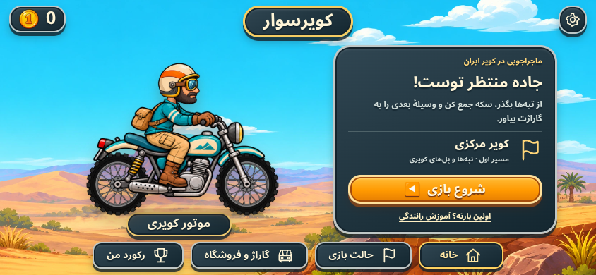
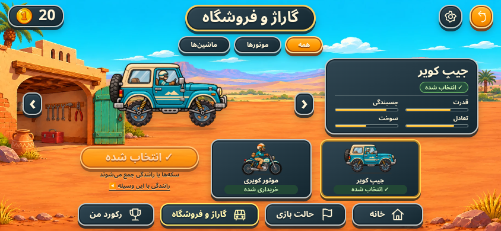
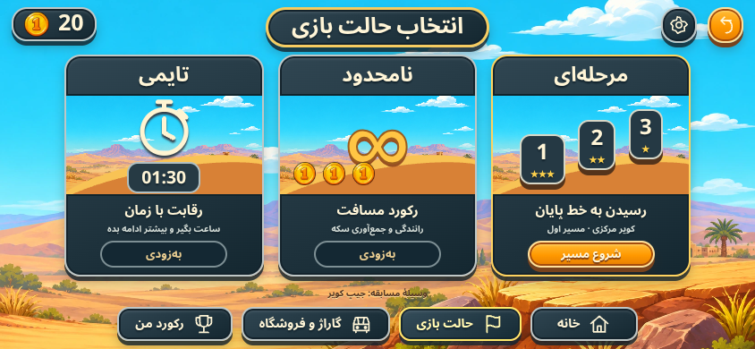
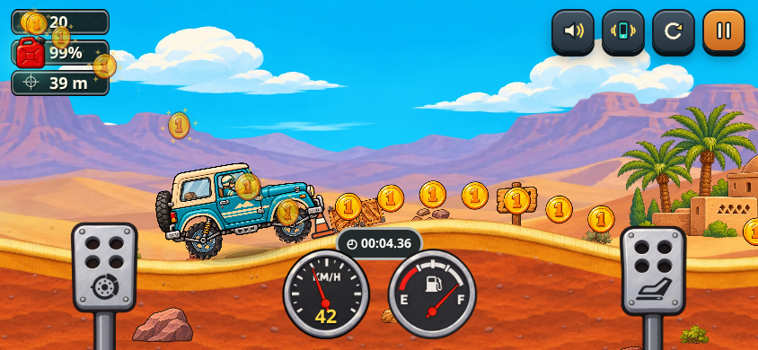

# خانه و گاراژ — مرحلهٔ اول

صفحهٔ خانه و انتخاب حالت با همان آسمان فیروزه‌ای، محیط کویری و قاب‌های فلزی بازی ساخته شده است. گاراژ شامل موتور اولیهٔ رایگان و جیپ کویر با قیمت اولیهٔ 300 سکه است؛ انتخاب، مالکیت و موجودی در ذخیرهٔ نسخه‌دار نگه‌داری می‌شوند. هر سکهٔ جمع‌شده در مسابقه بلافاصله به موجودی اضافه می‌شود، حتی اگر بازیکن ببازد، دوباره شروع کند یا به خانه برگردد. آموزش سکهٔ قابل خرج ایجاد نمی‌کند.

خرید تأیید دارد و در صورت کمبود موجودی غیرفعال است. خرید دوبارهٔ وسیلهٔ موجود هزینه ندارد. اگر ذخیره‌سازی دستگاه موقتاً خطا بدهد، اطلاعات نشست حفظ و در دسترسی بعدی دوباره ذخیره می‌شود.

جیپ در خود مسابقه قابل استفاده است: چرخ‌های مستقل، بدنه و کابین برخوردپذیر، فاصلهٔ محور و شعاع چرخ بیشتر، جرم و اینرسی بیشتر، چسبندگی و تنظیم کمک‌فنر متفاوت دارد. آموزش همیشه با موتور انجام می‌شود. رکورد موتور با کلید قبلی حفظ و رکورد جیپ جدا ذخیره می‌شود. از توقف، شکست و پایان مسابقه می‌توان به منو یا گاراژ برگشت.

حالت مرحله‌ای فعلاً همان مسیر فعلی کویر مرکزی را اجرا می‌کند. حالت‌های نامحدود و تایمی با برچسب «به‌زودی» نمایش داده می‌شوند. ارتقای قطعات و نقشهٔ چندمرحله‌ای در این مرحله پیاده نشده‌اند.

## بررسی

- TypeScript و ساخت production با Vite موفق شدند.
- 68 تست قبلی بازی و 7 تست جدید اقتصاد، ذخیره‌سازی، رکورد و فیزیک جیپ موفق شدند؛ موتور و جیپ هر دو با کنترل دوپداله می‌توانند مسیر اصلی را تمام کنند.
- 6 تست بسته‌بندی Python موفق شدند.
- بررسی در مرورگر واقعی: حساب تازه، جلوگیری از خرید بدون سکه، انصراف، خرید، کسر فقط یک‌بار هزینه، بارگذاری دوباره، اجرای جیپ و افزایش موجودی از دریافت واقعی سکه تأیید شدند.
- صفحهٔ گاراژ در اندازه‌های 640×320، 844×390، 1280×720 و 1536×692 بررسی شد؛ خطای JavaScript و درخواست دارایی ناموفق مشاهده نشد.
- موجودی‌های تصاویر از نشست آزمایشی مرورگر هستند و موجودی اولیهٔ بازیکن تازه صفر است.

## تصاویر نسخهٔ اجراشده

